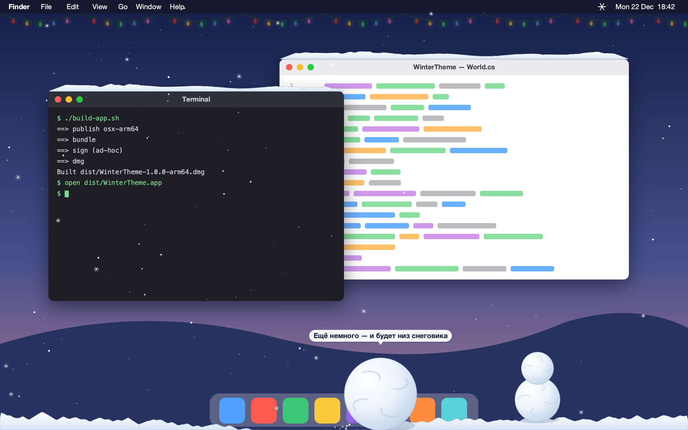
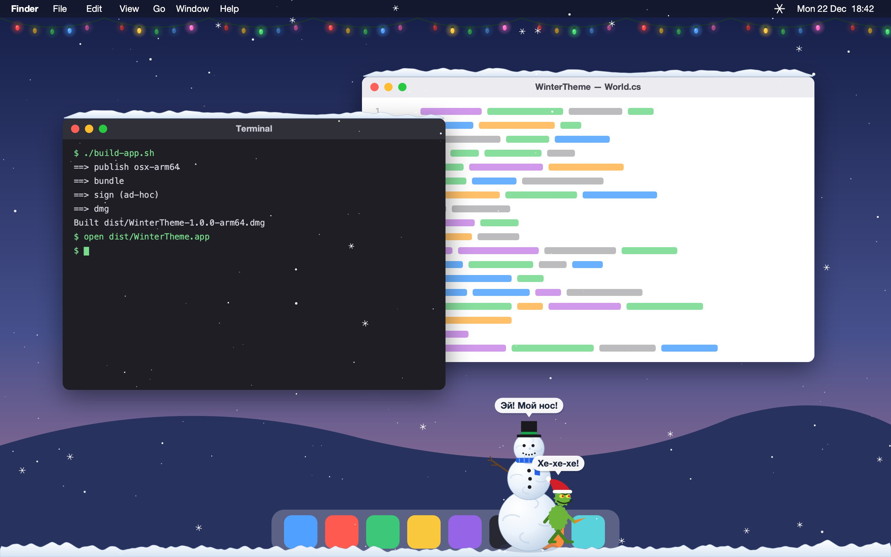
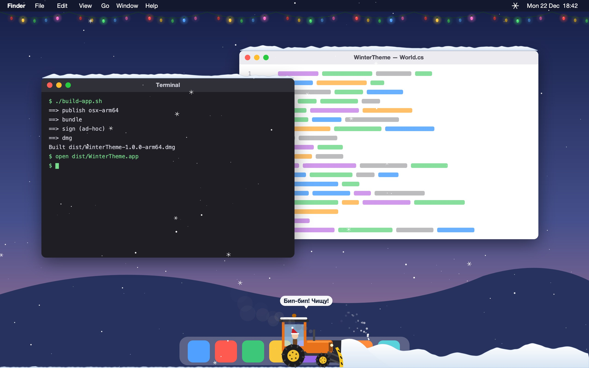
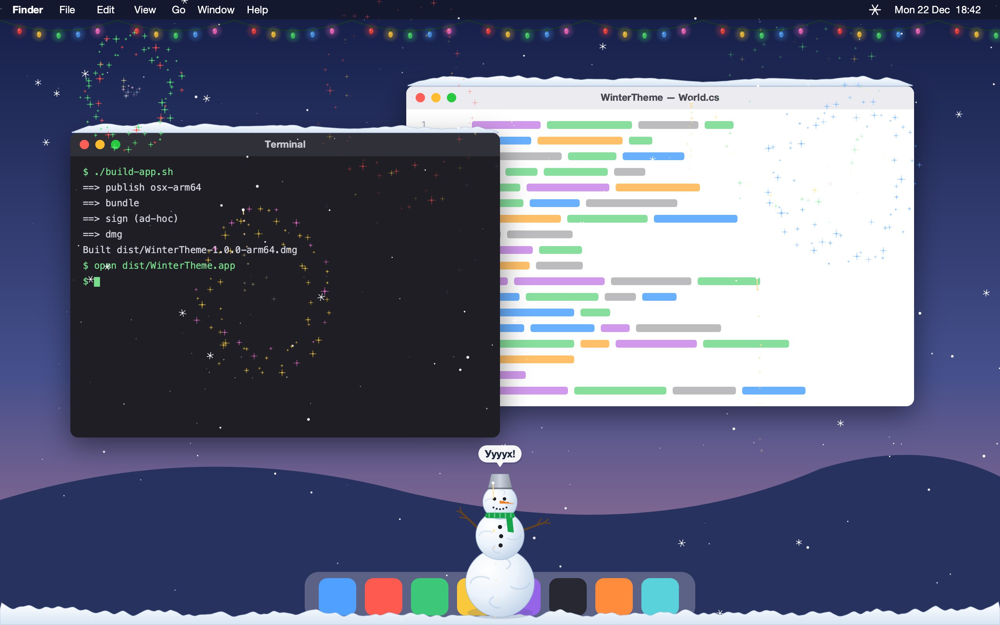
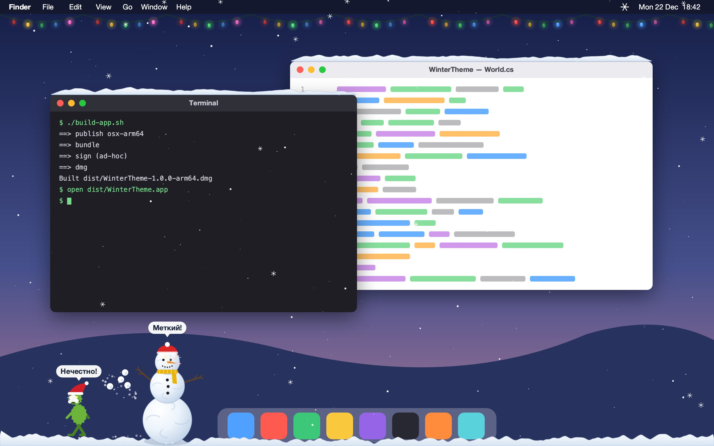
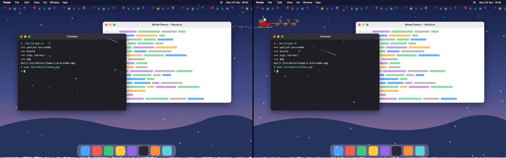
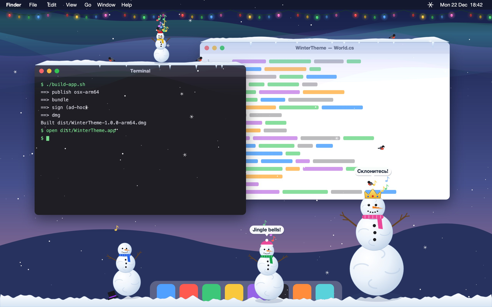

# Зимняя тема для macOS

A menu bar app (C#, .NET 10, Avalonia 11.3) that draws winter on top of the macOS desktop:

- Snow falls over everything and settles on the tops of windows and on the bottom of the screen.
  Moving or closing a window shakes its snow off.
- The cursor parts the drifts as it moves through them.
- When the ground drift gets deep, a tractor with a plow comes by and clears it. It also pushes small snowballs aside.
- **You build the snowman yourself:** hold **⌥ Option**, press on the drift and drag to roll a snowball.
  The ball picks up snow and grows. Drop a smaller ball onto a bigger one. Three stacked balls become a snowman
  with a face, carrot nose, scarf, hat and arms.
  Drag the top ball to take the snowman apart, or drag a lower ball to move the whole stack.
- The Grinch runs by now and then, steals a snowman's carrot nose or Santa's present, and leaves footprints.
  The nose grows back after 3 minutes, or you can ⌥-click the head to put it back right away.
- Santa flies by with reindeer and drops a present. Click the present to open it. Click the sleigh for up to 3 more.
- Presents hold about 70 different wishes, and sometimes a surprise: fireworks, a tiny snowman, a personal snowdrift,
  a blizzard, the tractor, a piece of coal for bad behavior, or the Grinch himself.
- **Snowball fight:** pick up a small ball and flick it with the mouse to throw it. Hit the Grinch and he drops
  the stolen present or gives the carrot back to its snowman.
- Snowmen talk now and then, and react to the tractor, the Grinch, Santa, fireworks and shooting stars.
  Some lines depend on the date and time: the days left until New Year, Dec 31, late night.
- Shooting stars cross the sky, more often in the evening.
- At midnight on Dec 31 there is a 10-second countdown, then fireworks, confetti and Santa.
  To see it right away, choose "Репетиция Нового года" in the menu. Fireworks are also in the menu ("Салют!").
- A garland of lights hangs under the menu bar.
- **Snowmen on windows:** drop a snowball or a whole snowman onto the top of a window. It rides along when you drag
  the window, and falls off when the window closes or minimizes, or when you jerk the window sharply. A fall from
  higher than about 160 points smashes a ball or a snowman into snow. You can also roll a ball along the snow on
  a window to grow it. The Grinch can't reach snowmen up there.
- More physics: loose balls roll down the drifts and push each other, strong gusts blow hats off (click a hat to put
  it back), wind blows powder off the drifts and window caps, icicles grow under snowy window tops (swipe the cursor
  through one to knock it down), and with melting on, snowmen shrink and collapse.
- Snowmen have names, follow the cursor with their eyes, and throw snowballs at the Grinch.
- Bullfinches land on windows, snowmen and the drift, and fly off when the cursor comes close.
- Northern lights on some nights (or from the menu).
- **Several displays work as one desktop:** Santa flies across all of them, the tractor drives on to the next display
  and clears it too, and the Grinch runs through. Drag a snowball or a whole snowman onto the other display,
  or throw a snowball across. Displays must touch side by side in System Settings → Displays.
  Turn it off with "Мониторы как один экран".


| Rolling a snowball | The Grinch took the nose | The tractor clears the drift |
|---|---|---|
|  |  |  |

| Fireworks | A snowball hit the Grinch and the nose is back |
|---|---|
|  |  |





<details>
<summary>Easter eggs (spoilers)</summary>

- Tap a snowman 5 times quickly: it dances. With three or more snowmen, they sing together.
- Build a snowman with a huge bottom ball: you get the Snow King with a crown. A tiny one squeaks.
- Hit the Grinch with three snowballs in one visit: his heart grows and he gives you a present.
- Keep clicking Santa's sleigh after three extra presents: you get coal.
- Shake a window fast: earthquake. Snowmen jump, presents bounce, hats fly off.
- Some presents hide a surprise, and snowmen have special lines at 13:37, on Friday evenings, Christmas and the Old New Year.

</details>

The screenshots are rendered with the app's own simulation and painter on a mock desktop:
`dotnet run --project WinterTheme -c Release -- --render-screens docs`.

Snowmen and settled snow are saved in `~/Library/Application Support/WinterTheme/`.

## Run

```bash
dotnet run --project WinterTheme   # dev
./build-app.sh                     # dist/WinterTheme-1.3.0-arm64.dmg (Apple Silicon)
ARCH=x64 ./build-app.sh            # Intel
ARCH=all VERSION=1.3.0 ./build-app.sh
```

## Install

Apple Silicon, one line in Terminal:

```bash
curl -fsSL https://raw.githubusercontent.com/fomenkodmitry/WinterTheme/main/install.sh | bash
```

It downloads the DMG, copies the app to `/Applications` and starts it. Files downloaded with `curl` are not quarantined, so there is no Gatekeeper prompt.
The snowflake appears in the menu bar. Turn on "Запускать при входе" there to start it at login.

Or download [`release/WinterTheme-1.3.0-arm64.dmg`](release/WinterTheme-1.3.0-arm64.dmg) and drag **WinterTheme** onto **Applications**.
The app is ad-hoc signed, not notarized, so macOS says it cannot verify that the app is free of malware. To open it anyway, do one of these:
- System Settings → Privacy & Security → click "Open Anyway" next to the WinterTheme message.
- Run `xattr -dr com.apple.quarantine /Applications/WinterTheme.app`.

## How it works

- `UI/OverlayWindow` creates one transparent, borderless Avalonia window per display. Through the ObjC runtime
  (`Native/Interop.cs`) the window gets `NSStatusWindowLevel`, joins all Spaces, and ignores mouse events.
  The window only turns interactive while the cursor is over a snowball or a present, or while ⌥ is held near the drift.
  After a click, focus goes back to the app that was in front.
- `Quartz.VisibleWindows()` reads `CGWindowListCopyWindowInfo` 10 times per second.
  Reading window bounds does not need the Screen Recording permission.
- `Sim/` holds the simulation: heightmap piles with slope relaxation, flakes, particles, snowballs, the tractor, the Grinch and Santa.
  `Render/Painter` draws everything with SkiaSharp.
- The overlay runs at 30 fps by default. "Плавно (60 fps)" in the menu turns on 60 fps, which uses more CPU.
  The snow is hidden from screenshots unless "Видно на скриншотах" is on.
