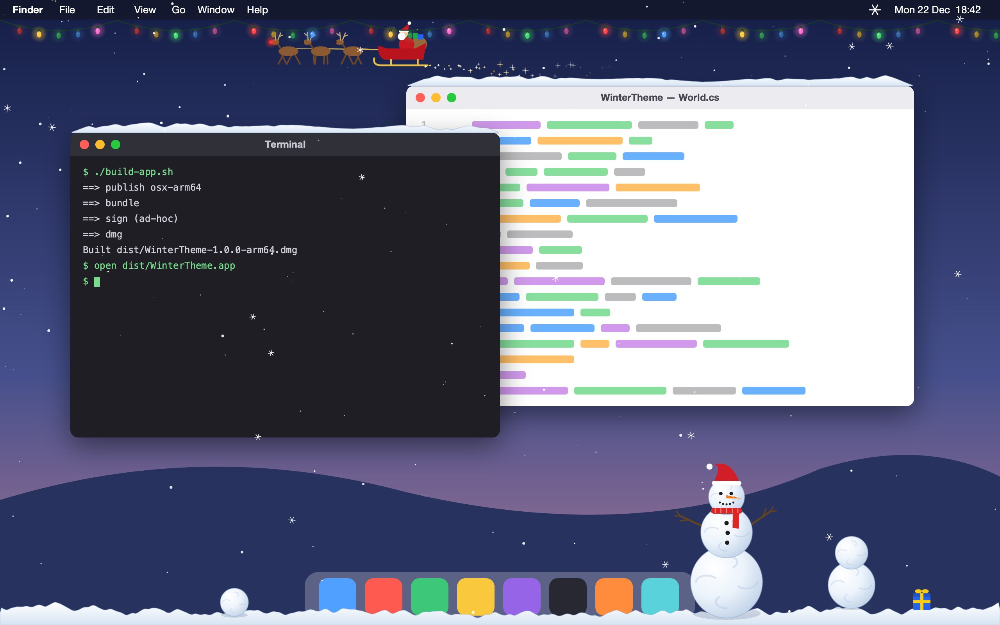

# Зимняя тема для macOS

A menu bar app (C#, .NET 10, Avalonia 11.3) that draws winter on top of the macOS desktop:

- Snow falls over everything and settles on the tops of windows and on the bottom of the screen.
  Moving or closing a window shakes its snow off.
- The cursor parts the drifts as it moves through them.
- When the ground drift gets deep, a tractor with a plow comes by and clears it. It also pushes small snowballs aside.
- **You build the snowman yourself:** hold **⌥ Option**, press on the drift and drag to roll a snowball.
  The ball picks up snow and grows. Drop a smaller ball onto a bigger one. Three stacked balls become a snowman
  with a face, carrot nose, scarf, hat and arms.
  Drag the top ball to take the snowman apart, or drag a lower ball to move the whole stack.
- The Grinch runs by now and then, steals a snowman's carrot nose or Santa's present, and leaves footprints.
  The nose grows back after 3 minutes, or you can ⌥-click the head to put it back right away.
- Santa flies by with reindeer and drops a present. Click the present to open it.
- A garland of lights hangs under the menu bar.



| Rolling a snowball | The Grinch took the nose | The tractor clears the drift |
|---|---|---|
|  |  |  |

The screenshots are rendered with the app's own simulation and painter on a mock desktop:
`dotnet run --project WinterTheme -c Release -- --render-screens docs`.

Snowmen and settled snow are saved in `~/Library/Application Support/WinterTheme/`.

## Run

```bash
dotnet run --project WinterTheme   # dev
./build-app.sh                     # dist/WinterTheme-1.0.1-arm64.dmg (Apple Silicon)
ARCH=x64 ./build-app.sh            # Intel
ARCH=all VERSION=1.1.0 ./build-app.sh
```

## Install

Apple Silicon, one line in Terminal:

```bash
curl -fsSL https://raw.githubusercontent.com/fomenkodmitry/WinterTheme/main/install.sh | bash
```

It downloads the DMG, copies the app to `/Applications` and starts it. Files downloaded with `curl` are not quarantined, so there is no Gatekeeper prompt.
The snowflake appears in the menu bar. Turn on "Запускать при входе" there to start it at login.

Or download [`release/WinterTheme-1.0.1-arm64.dmg`](release/WinterTheme-1.0.1-arm64.dmg) and drag **WinterTheme** onto **Applications**.
The app is ad-hoc signed, not notarized, so macOS says it cannot verify that the app is free of malware. To open it anyway, do one of these:
- System Settings → Privacy & Security → click "Open Anyway" next to the WinterTheme message.
- Run `xattr -dr com.apple.quarantine /Applications/WinterTheme.app`.

## How it works

- `UI/OverlayWindow` creates one transparent, borderless Avalonia window per display. Through the ObjC runtime
  (`Native/Interop.cs`) the window gets `NSStatusWindowLevel`, joins all Spaces, and ignores mouse events.
  The window only turns interactive while the cursor is over a snowball or a present, or while ⌥ is held near the drift.
  After a click, focus goes back to the app that was in front.
- `Quartz.VisibleWindows()` reads `CGWindowListCopyWindowInfo` 10 times per second.
  Reading window bounds does not need the Screen Recording permission.
- `Sim/` holds the simulation: heightmap piles with slope relaxation, flakes, particles, snowballs, the tractor, the Grinch and Santa.
  `Render/Painter` draws everything with SkiaSharp.
- The overlay runs at 30 fps by default. "Плавно (60 fps)" in the menu turns on 60 fps, which uses more CPU.
  The snow is hidden from screenshots unless "Видно на скриншотах" is on.
